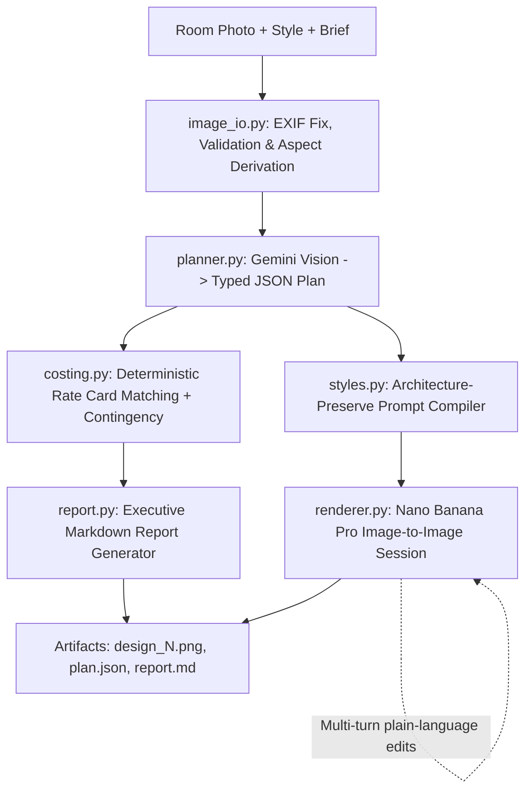

# 🏠 AI Home Renovation Agent

[](https://www.python.org/)
[](https://pypi.org/project/google-genai/)
[](tests/)
[](LICENSE)

An agentic AI pipeline that transforms any room photo into an **architectural condition report, itemized bill of quantities (BOQ), deterministic budget estimate, and photorealistic redesigns** using **Google Gemini Multimodal Vision** and **Nano Banana Pro** (`gemini-3-pro-image-preview`).

```
Input Photo ──► Gemini Vision ──► JSON BOQ Plan ──► Rate Engine ──► Nano Banana Pro ──► Executive Report
(room.jpg)       (Perception)      (Quantities)     (Market Rates)    (Image-to-Image)    (report.md + renders)
```

---

## 🎯 Why This Matters (Engineering Highlights)

1. **Zero LLM Price Hallucination (Deterministic Costing):**  
   Language models are notoriously inaccurate at arithmetic and pricing. This agent separates **perception** (LLM detects quantities and materials) from **valuation** (deterministic costing math matched against CPWD / RSMeans market rate cards).
2. **Geometry-Locked Redesigns:**  
   Standard diffusion models alter room architecture. Our prompt engine enforces strict spatial preservation rules (camera angle, window cutouts, ceiling heights, door positions) so designs are realistic and remodelable.
3. **Stateful Multi-Turn Refinement:**  
   Maintains conversation session context across iterations ("make the wall warm white", "replace carpet with herringbone wood") without reloading the base image from scratch.
4. **Cost-Aware Fail-Fast Design:**  
   Image validation, aspect ratio derivation, EXIF orientation corrections, and schema checks run locally *before* triggering any billable cloud inference calls.
5. **100% Offline CI/CD Coverage:**  
   Includes a full mock-client suite covering edge cases (network 503 backoff, thought-image filtering, malformed JSON repair) that runs in <0.5s for zero cost in CI.

---

## 🏗️ Architecture



| Component | Responsibility | Tech / Pattern |
|---|---|---|
| [`planner.py`](src/renovation_agent/planner.py) | Multimodal visual perception, defect detection, and BOQ extraction | Gemini Multimodal + Strict JSON Schema |
| [`costing.py`](src/renovation_agent/costing.py) | Deterministic cost computation across regional rate cards | Pluggable JSON Rate Cards + Mathematical Aggregation |
| [`styles.py`](src/renovation_agent/styles.py) | Compiles architectural preservation rules + aesthetic characteristics | 9 Interior Design Archetypes |
| [`renderer.py`](src/renovation_agent/renderer.py) | Stateful image synthesis, thought-token filtering, retry & backoff | Gemini Chat Session + Exponential Backoff |
| [`agent.py`](src/renovation_agent/agent.py) | Pipeline orchestration, lifecycle handling, artifact persistence | Facade / Orchestrator Pattern |
| [`report.py`](src/renovation_agent/report.py) | Generates executive renovation report with visual before/after | Markdown with Gallery & Phased Roadmap |

---

## ⚡ Quickstart

### 1. Installation
```bash
git clone https://github.com/iitking/ai-home-renovation-agent.git
cd ai-home-renovation-agent
python3 -m venv .venv && source .venv/bin/activate
pip install -e ".[dev]"
```

### 2. Configure Key
```bash
cp .env.example .env
# Set GEMINI_API_KEY=your_key in .env (Get free key from https://aistudio.google.com/apikey)
```

### 3. Run

```bash
# Option A: Launch Interactive Browser Web UI
python app.py
# (or via CLI: renovate ui)

# Option B: Run via CLI
# Inspect market rate cards (India Metro, Tier 2, US Standard)
renovate rates

# Run renovation pipeline on included sample photo
renovate run --image examples/room.jpg --style japandi \
  --brief "budget 3 lakh, maximize storage and natural light" \
  --variants 2 --interactive
```

*(Sample high-res test photos included: `examples/room.jpg`, `examples/bedroom.jpg`, `examples/kitchen.jpg`)*

---

## 💻 Python Library Usage

```python
from renovation_agent.config import Settings, make_client
from renovation_agent.agent import RenovationAgent
from renovation_agent.costing import load_rates

settings = Settings.from_env()
agent = RenovationAgent(settings, make_client(settings), rates=load_rates("india-metro"))

# Execute end-to-end renovation run
result = agent.run(
    image_path="examples/room.jpg",
    style="scandinavian",
    brief="modern lighting, low-profile furniture",
    variants=2,
    contingency_pct=15.0
)

print(f"Total: {result.estimate.currency} {result.estimate.total:,.0f}")
print(f"Rendered: {result.renders}")

# Multi-turn plain language edit on design 1
refined_path = agent.refine(result, "change flooring to dark walnut wood")
print(f"Refined design saved to: {refined_path}")
```

---

## 🎨 Design Archetypes & Regional Rate Cards

- **9 Supported Styles:** `japandi`, `scandinavian`, `modern`, `minimalist`, `industrial`, `luxury`, `indian-contemporary`, `mid-century`, `bohemian`.
- **Preloaded Benchmark Rate Cards:**
  - `default` / `india-metro`: Tier 1 Indian Metros (Bengaluru, Mumbai, Delhi-NCR, Hyderabad) based on CPWD benchmarks.
  - `india-tier2`: Tier 2 / 3 Indian cities with localized labour/material indices.
  - `us-standard`: US national averages in USD ($/sqft, $/LF, $/unit) benchmarked against RSMeans and HomeAdvisor data.

---

## 🧪 Testing & CI

```bash
# Run complete offline unit & integration test suite (0.3s runtime)
pytest -v
```

```
============================== 37 passed in 0.30s ==============================
```

- **Mock Client Harness:** Tests pipeline end-to-end with simulated Gemini payloads, image tensors, and transient API failures without consuming tokens.
- **Live Smoke Testing:** Dedicated opt-in test (`RUN_LIVE=1 pytest tests/test_live.py`) validates live connectivity against real Google AI infrastructure.

---

## 📄 License
MIT License. Free for personal, commercial, and research use.

---

## 👨💻 Author

<div align="center">

<a href="https://github.com/iitking">
  
</a>

### **Nivesh Kumar Meena**

**AI Architect · MLOps Engineer** | B.Tech Electrical Engineering, **IIT Roorkee**

*Building agentic AI systems, RAG pipelines and production-ready ML.*

<a href="https://www.linkedin.com/in/nivesh-kumar-meena-a31465221/"></a>
<a href="https://github.com/iitking"></a>
<a href="mailto:niveshkr149@gmail.com"></a>

<br/><br/>

⭐ **If you found this project useful, please give it a star!** ⭐

<sub>Open to AI/ML engineering opportunities and collaborations.</sub>

</div>

---

<div align="center">
  <sub>Made with ❤️ by <a href="https://github.com/iitking">Nivesh Kumar Meena</a> · © 2026 · MIT License</sub>
</div>

